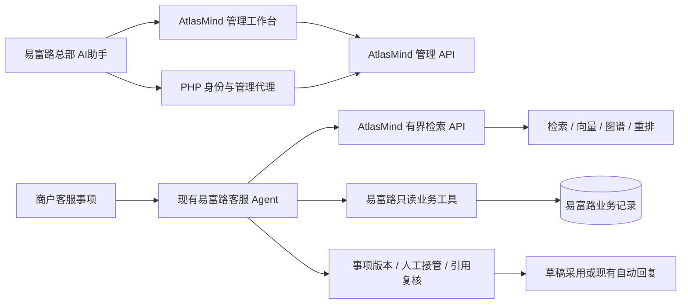

# 易富路智能客服接入 AtlasMind：核查与阶段方案

核查日期：2026-10-11。AtlasMind 基线：`001-enterprise-agentic-rag` / `7203769ae3f7c847b5f3925d20e9ce3939565b7f`。易富路基线为核查时未提交工作区，不代表远程提交。此前完成启动与只读核查；用户已授权直接实施精简三阶段，最新结果见第 9 节。

## 1. 结论与边界

### 2026-10-12 商户手册只读增量

客服listener新增POST `/v1/knowledge/manual/list`（query/page）与`/manual/read`（document_id及可选version_id、chunk_id/digest、page、view、paragraph_start/end、quote_digest）。固定scope030；`merchant-manual`短期JWT独立于Agent用途，必须run_id=0及正整数merchant_id/principal_id。目录20条/页，默认chunk视图兼容旧调用；商户阅读页使用view=document获取完整同版正文，最多500块/120KB、返回250KB。Markdown不可变原对象须与规范段落一致才恢复安全结构，不传原HTML/URL；其他格式回退规范文本。所有范围完整可见，版本/chunk/摘录摘要均复核；失效来源不重定向到新版。易富路通过权限保护GET代理，浏览器不接触服务密钥，阅读不调用模型。

客服最终回答在同一次模型调用生成JSON answer/citations，ref映射本轮签名检索来源，quote只能是唯一且完整的原文段落。Python先校验再发布正文，PHP独立验证并保存citation_mode=paragraph-v1及可信段落编号/quote_digest；新引用仅选段黄色高亮，旧引用灰色参考范围，不迁移猜测旧引用。复用现有MarkdownIt/BeautifulSoup及Vue递归安全节点，不新增库、编辑器或第二次生成调用。实际验证与用户页面验收边界见PROJECT_STATUS。

### 2026-10-12 自动回复增量（当前范围）

同日商户助手增量：用户授权两个商户入口共用公开规则知识。新增`sub=merchant-assistant`，仍固定scope030；PHP校验merchant_ai权限、完整run owner和auth_revision，不创建虚假客服事项，不开放总部scope020。原auto/draft用途、接口和服务密钥兼容。助手平台规则先检索当前来源，模型上下文只使用有界文本副本，原始签名来源及版本复核保留。最新验证与部署记录见PROJECT_STATUS；下文draft-only及只覆盖客服的表述为历史实施阶段。

用户授权恢复“联系总部”智能回复并让自动回复与总部人工建议共用客服知识。`knowledge-service` 现在接受 `sub=hq-draft/merchant-auto`，仍固定客服scope030，保留原issuer/audience和服务密钥；HQ普通知识020仍独立。PHP基于任务模式签发用途，验证提供者账号、商户及当前事项版本，模型不能指定scope/provider。外部失败不静默回退旧知识；空候选且检索分支失败返回503。下文2026-10-11的draft-only限制为历史首版范围，已被本节用户授权增量替代。

复用既有httpx模型传输、JWT及Guzzle、客服任务/版本锁，不引入新Agent/认证/队列。连接、鉴权、超时及知识故障使用安全类别；自动任务失败幂等转人工，入队失败保留商户消息，人工领取后不允许迟到发布，恢复须Worker与模型就绪。Atlas启用时管理入口统一到同一工作台，隐藏旧本地知识编辑；关闭外部来源后新任务沿用本地来源，旧外部引用继续失效关闭。

已恢复Docker失效手动代理及停止的检索依赖，保留证书校验、密钥和数据卷。统一 `Start-YifuluMvp.ps1` 补依赖等待/Ollama预热，新增 `-ReloadKnowledgeService` 保留开关仅重载现有客服服务。`-EnableTrial` 当前开启客服来源用于auto与draft，省略则关闭外部来源，不调整全局自动回复开关；`-EnableHqKnowledge`仍独立。

真实网关 `service-live.php --allow-writes --allow-model-calls --automatic --atlasmind --http` 的run500/501两项通过，分别验证有引用的自动发布与无依据转人工；夹具精确清理、用量账本保留。安全/HQ34项、隔离存储46项（包含重叠）、易富路客服45项/组件34项/运行时26项通过，相关语法及SFC编译通过。调试中曾出现间歇bridge拒绝，保留安全位点日志及失败证据；有限通过不等于长期稳定性。UI人工验收待完成；详细事实见 PROJECT_STATUS。

### 2026-10-11 总部普通知识增量（用户已确认，已运行验证）

总部“AI助手 → AI对话”现接入普通文档，包括已上传简历；独立 `hq-knowledge-service` / scope尾号020，与客服draft的 `knowledge-service` / scope尾号030保持隔离。复用现有FastAPI、LangGraph检索、PyJWT/Firebase JWT和Guzzle，不引入新的Agent框架或知识库。只有服务器配置能够选择范围及服务地址，总部知识服务没有上传、管理或客服搜索路由，也不发布主机端口。

`POST /v1/knowledge/answer` 接收 query（1～4000字）与最多8条 user/assistant 历史（每条≤600字），禁止额外身份、scope或system消息。JWT用途为 `iss=yifulu-hq`、`aud=atlasmind-hq-knowledge`、`sub=hq-chat`，包含正整数principal_id/run_id；PHP有效期40秒，服务最大60秒，与客服独立密钥。返回 `route=business` 时不检索文档并沿用原业务模型；知识返回 route、answer、最多5条选中且复核的 citations（document_id/version_id/chunk_id/title/locator/digest），没有知识原文。复核接口接收4个引用身份字段，不接受scope。

知识路径使用AtlasMind已有模型及 grounded-identity-v2，最多4次生成调用（分类、检索规划、重排、回答）、3次Embedding、原6秒检索预算和30秒总接口期限、2个并发槽；调用异常明确失败。PHP生成后与最终发布、事件、历史再复核来源，撤销/换版/权限变化时关闭输出。原SSE用于分块发布已完成答案，不表示Atlas模型上游token流。帮助、明确业务编号及绑定商品/订单会话继续原处理。普通问答不借用易富路失效密钥；业务模型仍独立配置。

通过 `scripts/Start-YifuluMvp.ps1 -EnableHqKnowledge` 已完成本机配置及仅总部Worker重载。原问题真实重放218/219成功，仅引用现有活动简历PDF；末次26项真实模型/HTTP/权限及回放验证、10项无模型HTTP验证、17项组件逻辑检查通过，相关源码/编译检查通过。AtlasMind31项单元/安全与45项隔离存储/接口回归通过；详细边界见 PROJECT_STATUS。没有浏览器UI或容量验收。此增量不改变客服自动回复、商户隔离或业务写入权限。

### 2026-10-11 精简 MVP（已授权实施）

目标：先交付可以实际试用的“上传客服知识 → 易富路生成有来源的回复建议 → 总部人工采用发送”。首版限定本机管理、单一指定知识管理员和商户通用客服知识；易富路仍使用现有总部权限与商户业务隔离。这里的试用范围不包括公网多账号知识管理或商户私有知识库。

| 首版保留 | 做法 |
|---|---|
| 上传、换版、撤下知识 | 直接使用 AtlasMind 已有页面；指定管理员上传前审阅，处理成功即生效。暂不增加草稿审批系统或第二套编辑器 |
| 两个管理入口 | AtlasMind 直接管理；易富路“AI助手”二级入口跳转到同一工作台。首版不承诺易富路页面内直接编辑 |
| 客服使用知识 | 新增薄的服务端检索/引用有效性接口，复用 AtlasMind 检索流水线；易富路只增加 knowledge_search 适配及外部来源表示 |
| 订单、售后、商品查询 | 沿用易富路现有 record_read/record_search 和服务器商户过滤，业务记录不迁入 AtlasMind |
| 可控试用与回退 | 新检索先用于总部人工采用的建议；现有自动回复范围和开关不在本期扩大。外部检索失败或引用失效时停止采用、交由人工；关闭试点可退回既有流程 |

本期不做：SSO/企业 IdP、两套原生管理页面、SQL 连接器/查询库/数据源管理、多管理员协作/CAS 界面、复杂发布审批、双向同步、独立 Agent Worker、新 BM25/Cross-Encoder、图谱升级或全套评测平台。已实现且可用的检索能力可继续复用，是否启用昂贵策略按实际模型烟雾结果与时延决定。

必须保留的最小边界：

- 服务端调用认证与固定的客服知识授权范围；复用现有 JWT/网关组件，不自创认证协议。服务入口只放行检索/引用验证，不能凭该凭据调用上传、撤下或管理接口；原 local 管理端继续仅本机访问，不能因跨容器接入将整套免认证 API 暴露给业务调用方。
- 只导入已审阅的商户通用知识；客服授权范围在检索及模型消费前确定。模型和浏览器不能扩大 scope；总部内部和商户私有文档不进入试点候选集。
- 复用易富路既有商户隔离、事项版本、人工接管、Source 签名和模型额度控制；新增检索调用设置超时、条数/字节与模型调用预算，记录基本调用成本和关联日志。
- 建议采用/展示时验证引用的活动版本与可见性；撤下、换版、超时或未知状态不能继续作为有效依据。导入/换版与撤下并发必须执行针对性回归，发现实际缺陷时修复后再接入。

知识首版直接在 AtlasMind 维护，不建立持续同步。可以一次性导入核准的少量原文，重新嵌入；新增知识不双写易富路旧知识表。旧链路继续承担尚未切换的场景，后续正式切换时再统一旧编辑入口，不在试点阶段破坏既有自动回复。

实施前估算为 **4～7 人日**，以模型配置可用、复用既有页面/Agent/工具、采用上述有限试用范围为前提；不是当前剩余工期。第 7 节保留精简后的阶段安排，实际实施与验收见第 9 节。第 3～6 节保留完整方向的技术依据，属于后续扩展设计，不作为首版的全量交付清单。此前 12～20 / 18～30 人日对应更完整的治理与管理范围，不是本版 MVP 的工期。

## 2. 源码能力与缺口

以下为实施前核查，“已有”表示当时源码可追踪；首次启动结果见第 8 节，最新实施结果见第 9 节，历史状态文档中的通过不视为本机通过。

| 能力 | 当前代码事实 | 接入缺口 / 证据 |
|---|---|---|
| 文档接入 | 原文进 S3/MinIO，版本/分块/向量入 PostgreSQL，独立 ingestion worker；TXT/MD/HTML/PDF/DOCX 解析 | 无文件夹/企业内容源持续同步；`application/real_mvp.py`、`ingestion/parsers.py`、`workers/real_ingestion.py` |
| 版本与撤销 | 不可变版本、导入完成切换 active version；撤销先置数据库不可见，再清理图投影 | 不等同于草稿/审核/发布工作流；当前处理完成会自动激活；没有 API `If-Match`/预期编辑版本；`api/app.py`、`real_mvp.py:add_version/process_next/revoke_document` |
| 混合检索 | pgvector + PostgreSQL FTS + Graph 回查原始 Chunk，RRF 融合；固定 LangGraph 阶段、预算和策略校验 | BM25 名称实际是 FTS `websearch_to_tsquery/ts_rank_cd`，缺少真正 BM25 与中文质量/规模验收；`retrieval/advanced_workflow.py` |
| 重排 | 有候选数、超时、ID 校验和失败回退；OpenAI-compatible 生成模型 listwise 排序 | 未接入 Cross-Encoder / bge-reranker；`infrastructure/openai_compatible.py`、`retrieval/reranker.py` |
| 图谱 | Neo4j GraphRAG 抽取、授权 seed/path、关系 provenance、活动版本回查 Chunk；检索最多两跳 | Explorer 三跳不代表检索三跳；未实现社区 Global Search、Graph seed 再触发文档扩展；图路径 metadata 未进入最终模型 Context；`infrastructure/neo4j_runtime.py`、`advanced_workflow.py` |
| SQL 查询 | 服务器白名单 Dataset/metric/dimension；值参数化；scope 条件；`SET TRANSACTION READ ONLY`，真实 `session.execute` | 默认 Runtime 没传 Dataset，工具不注册；复用 AtlasMind 的 PostgreSQL session，不能直接连易富路 MySQL；没有数据源 CRUD、凭据治理/连接探测/独立引擎；`tools/sql_query.py`、`application/rag_capabilities.py`、`runtime.py` |
| SQL 管理 UI | “连接 SQL 数据源”面板明确待接入，保存按钮禁用 | 不是可用数据源管理；`frontend/src/components/knowledge/knowledge-workbench.tsx:77` |
| 异步问答 / SSE | POST 202、进程内 `asyncio.create_task`；PUBLIC 事件 PostgreSQL 持久化、序号/断点回放、所有者检查、终态控制 | 无持久任务续跑/真实独立 Agent Worker；`workers/agent.py` 使用 InMemory repository，Compose 未部署 Agent Worker；`api/app.py`、`real_mvp.py:start_ask` |
| 身份与授权 | 有 OIDC verifier、trusted AuthContext、scope/action/revision 与授权组件；前端有 OIDC/BFF 代码 | 真正 `runtime_auth_context` 忽略令牌，local 固定全角色；非 local 返回 OIDC_RUNTIME_NOT_CONFIGURED；不能靠前端 SSO 完成 API 身份；`api/app.py:runtime_auth_context`、`identity/oidc.py` |
| 对象授权 | 文档查询带 scope，运行读取按 principal；Advanced RAG 查询前过滤、图 provenance 复核 | `get_job/retry_job` 不接收身份/scope，真实路由丢弃 `_context`；管理写操作需统一 Action 和最新 revision 校验；接入前测试两个互斥商户/管理员 |
| 审计与治理 | 上传、运行、能力调用、版本/撤销等有 PostgreSQL audit/trace；审计链 hash 代码 | local actor 不能区分真实操作者；缺外部审计浏览/查询 API，不能把 UI 治理栏目当完整实现；`observability/*`、`real_mvp.py:_append_audit` |
| 外部调用 / 审批 / 评测 | 外部 API 白名单适配器、执行网关、审批与评测应用/测试代码存在 | `create_app` 未装配对应独立路由；capabilities 明确 approvals/evaluations=false；没有易富路 transport/endpoint 注册；`tools/external_api.py`、`api/routes/*`、`api/app.py` |
| 管理 API | 真实入口有文档/版本/任务、运行、图谱浏览与策略、RAG 策略 GET/PUT | 缺数据源管理、知识草稿发布、引用批量有效性、对象权限治理与审计检索；README 部分“占位”描述与已存在 RAG GET/PUT 漂移，应以实际 OpenAPI/代码为准 |

易富路只读核查依据（相对于 `../yifulu-yifulu2.0.1/`）：

- `后端/addon/ai_assistant/app/service/core/support/ServiceKnowledge.php`：客服知识复用 `ai_knowledge`，限定 public/merchant/customer_service；保存检查 published_version，检索最多 5 条、每条 2000 字；seed 定义 3 条说明。本次未查询易富路数据库，不能据此确认当前实际条数。
- `后端/addon/ai_assistant/app/service/core/merchant/MerchantTools.php`：客服仅允许 knowledge_search/record_read/record_search；商品 supplier_id、订单 take_store_id、售后供应商+本店订单及明细三重约束；结果签名与重新执行/hash 复核。
- `后端/addon/ai_assistant/app/service/core/support/ServiceCaseAgent.php`：独立 customer_service 会话；case_version、权限 revision、领取/人工接管防迟到发布；知识引用目前假定本地整数 ID/published_version，不能直接套 AtlasMind UUID。
- `后端/addon/ai_assistant/app/service/core/support/ServiceCaseAccess.php`：总部 ai_service/ai_service_manage、商户受控路由；总部原生管理界面及插件副本必须保持一致。

## 3. 推荐调用架构与备选

有界检索 API 是待新增的正式对外契约，当前 `/v1/agent-runs` 是完整问答，不能假定已有纯检索接口。返回授权 Chunk 原文、document/version/chunk/locator、来源类型、摘要/hash、scope/revision、限制与策略版本；最终客服回答仍由现有 Agent 生成。PHP 仅维护客户端/DTO、身份映射与必要缓存，不迁入 AtlasMind 检索实现。需确认既有额度是否覆盖 AtlasMind 检索规划、Embedding、listwise 重排等额外模型调用，不能静默把新增成本计入原有单次聊天额度。

备选 A：易富路调用 AtlasMind 全量问答 API，AtlasMind 经受控只读 API 查易富路。减少现有 Agent 编排，但需要改客服 run/event/额度/引用适配、业务 transport 和持久任务边界，风险与工期更高；适合未来明确统一 Agent 引擎时单独批准。

备选 B：仅管理入口跳转、现有客服不接检索。最低成本验证知识管理，不能声称客服已复用高级检索。

不推荐：双数据库可编辑知识双向同步、把向量/图谱迁入易富路、共享易富路 MySQL 写账号，或模型自行选择商户。它们增加冲突与权限成本。

## 4. 两个管理入口与同一份数据

| 路线 | 两处如何管理 | 优缺点 / 前置条件 |
|---|---|---|
| 第一阶段跳转 | 易富路二级入口打开 AtlasMind，相同知识库；开发期 local 仅限本机 | 最少前端代码；是“从两处进入管理”，不是两套原生编辑；生产必须先完成身份边界 |
| SSO 跳转 | 同一 IdP 或受信短期登录交换建立 AtlasMind BFF 会话，使用同一 API | 不重复登录；需校验 issuer/audience/签名/到期/nonce/防重放与退出；不能 URL 携带易富路长 token，也不能把普通业务 token直接当 OIDC |
| 后续原生管理 API | 易富路 PHP 用当前总部权限代理相同 CRUD/发布/数据源 API；AtlasMind 工作台调用同一服务 | 两处均可直接管理；需两边适配同一 DTO、冲突、发布、错误与审计；复杂页面仍跳转 |

身份映射由受信服务端生成：保留稳定 `(issuer, external_subject)` → AtlasMind principal 映射；将企业/总部角色、merchant_id 对应到独立 scope，区分“操作者总部账号”和“此客服事项的商户主体”。merchant_id、scope、角色、action 不接受浏览器/模型覆盖。总部拥有管理权限不意味着客服检索自动拥有全部商户权限。所有写 API 校验 MANAGE，读/引用校验 READ/CITE，运行与导入任务校验对象归属；每次关键输出重新检查最新授权 revision。服务凭据只是认证调用者，不授予跨商户全权。

知识至少区分“商户通用客服”、“总部内部”和各商户私有内容。通用知识并不等于匿名公开。公共规则和商户 scope 的 OR/AND 语义需要在现有 `<@` / `&&` 查询行为下统一并测试；不能只拼 UUID 数组推断隔离已经成立。

AtlasMind 应补齐最小管理契约：知识草稿、原文/metadata、不可变版本、审核/发布/撤下、权限绑定和有限列表；数据源登记/停用/连接测试、Dataset 版本与字段指标；审计查询。连接凭据存 AtlasMind 的既有部署密钥机制或外部秘密管理服务，只返回 secret_ref/是否已配置，浏览器不回显密码，易富路不持久化第二份凭据。未知连接地址不得直接连通：白名单、最小出站网络、超时、只读账号和连接探测权限共同约束。

同一管理服务执行 optimistic concurrency：读取返回 revision/ETag；修改、发布、撤下提交 If-Match，过期返回 409/412并让用户刷新比较，不自动覆盖。发布检查预期草稿 revision 和必需投影就绪，原子切换 active version；导入完成只表示已索引，不能自动发布未经审核的客服内容。索引失败保留旧发布版；紧急撤下先同步禁止检索/引用，再异步清理投影。后到的旧任务不能重新激活已撤下或已被更新的版本。

审计只保留一个权威 AtlasMind 知识/数据源变更日志，记录真实 actor、入口 origin、resource/version、操作、结果、correlationId/idempotencyKey；易富路记录客服发送/采用及外部调用关联，不复制整套知识审计。审计不得记录密钥或完整敏感业务结果。

## 5. 迁移、同步与引用有效性

首批仅迁移核准的商户客服知识原文与 metadata，不把总部内部/历史遗留知识整体开放。记录 `yifulu:service-knowledge:<id>` sourceKey、原始 published_version、文本 hash、AtlasMind document/version UUID 和授权 audience。迁移是一次性导入加数量/hash/可见性对账，切换后 AtlasMind 是知识编辑权威；易富路旧编辑入口禁用或代理，避免两个写源。

如果易富路在过渡期仍是特定来源的权威，只做该来源单向同步：版本事件/outbox、幂等 `(source, id, revision)`、乱序忽略、撤下 tombstone、失败重试/死信与周期 reconciliation；该来源在 AtlasMind 不可独立编辑。不同来源可有不同 owner，但单个条目永远只有一个写入权威。当前持续同步连接器未实现，需正式增加，不能宣称现成可用。

不要复用易富路旧向量。用原文在 AtlasMind 重新解析/分块/Embedding，记录 parser/chunker/model/provider/version/dimension。只在上述签名、授权与内容 hash 都相同的边界内复用向量；模型/分块器变化建立新 generation，完整检索验收后切换。不同版本仍有独立 provenance，不能因为相同内容 hash 就共享生命周期。仅修改展示 metadata 时可以不重新嵌入；影响检索、授权或分块含义时按影响重建。

易富路现有 Source V2 签名/引用 DTO 不直接兼容 AtlasMind UUID，需版本化外部知识 source 类型与映射，保留旧本地结果的读取兼容。发送/采用/历史展示前批量验证 source document/version/chunk 活动、发布、scope、最新授权与摘要/hash；新增受控引用验证 API，避免依赖重新搜索排序结果逐字相同。网络失败或撤下状态未知时不自动发送，转人工；禁止把私有原文写入普通客服消息。撤下/换版事件可驱逐缓存，但发送前验证是最后边界，不仅依赖 webhook 成功。

## 6. 业务数据接入

**首选实时只读业务 API**：首期继续现有易富路 record_read/record_search，不复制订单为长期知识。以后若 AtlasMind 工作台问答也需要业务数据，注册受控工具，由易富路验证短期委托身份、最新商户归属和对象权限，限定字段/数量/日期/查询次数。业务数据结果包含 authority、business key、observedAt、查询参数摘要、权限 revision 和限制；答案说明查询时点。模型只能选择语义参数；服务器独立确定商户；禁止依赖 Prompt 隔离。AtlasMind 管理页可配置工具/Dataset 定义，但不能更改易富路权威业务事实或业务权限。

**后续聚合只读 SQL 库**：仅在 API 无法满足已证明的指标性能需求时引入。独立复制/ETL PostgreSQL 查询库、白名单视图、独立只读连接与最小账号；不把真实业务表塞进 AtlasMind 自己的知识事务数据库。当前 SQL compiler 使用 PostgreSQL `ANY`，没有 MySQL adapter/连接管理，不能直接连接易富路 MySQL 后声称兼容。若必须查询 MySQL，应新增相应 port/parameter dialect、事务/超时/行级权限验证。

查询库每行绑定企业/商户业务键与更新时间/watermark，数据库 RLS或受控租户视图/服务器参数过滤形成硬边界；测试跨商户 join/聚合、空 scope 与伪造 filter。Dataset 注册仅允许受信管理员选择审核过的表/指标表达式，模型永远不提交 SQL/表名/列名。禁止任意数据库账号、DDL/DML、多语句、自由 JOIN；设置 statement timeout、最大行数/字节/并发和审计。事实以易富路为准；标记复制延迟，关键当前状态重新调用业务 API；停用数据源或撤权后缓存立即失效。

## 7. 阶段工作、验收与回退

以下为实施前阶段安排：按一名熟悉两项目的工程师、人日 8 小时估算，包含必要联调缓冲，总计 4～7 人日；不是承诺交付日期。当前实施状态见第 9 节。

| 顺序 | 工作 | 验收出口 | 预计 |
|---|---|---|---|
| 1 跑通真实知识 | 配好生成/Embedding，使用现有上传与检索；少量核准 FAQ 原文入库，固定可用环境依赖 | 真实上传、问答引用、换版/撤下烟雾通过；记录实际时延和模型费用 | 0.5～1 日 |
| 2 接上易富路 | 固定范围的服务认证、纯检索及引用复核；现有 knowledge_search/Source 适配；AI助手二级跳转入口；只接总部建议试点 | 能用 AtlasMind 知识产生回复建议并人工采用；订单/售后仍使用现有工具；未授权调用及管理路由不可达 | 2～3 日 |
| 3 验收交付 | 10～20 个代表问题；两商户业务隔离、引用换版/撤下、超时/不可用、事项变更/人工接管回归；人工 UI 验收 | 核准 FAQ 的可回答问题命中有效依据并产出可采用建议，无依据的问题明确转人工；零跨商户记录泄露；失效引用与迟到结果不发布；可关闭试点恢复原流程 | 1～2 日 |

回退按试点开关执行：停用外部知识来源、丢弃未采用的试点建议，保留原人工与既有客服链路。不得把 AtlasMind 已撤下知识重新复制到旧表以绕过失效校验。

后续按实际使用需求逐项增加：先考虑两处原生管理/多管理员认证，再考虑数据源管理和 AtlasMind 独立业务问答；SQL 查询库、持久任务恢复与检索引擎升级在明确需要时单独估算。若要求公网或多账号运行，应先补相应管理身份与对象授权；上述本机 MVP 估算不覆盖该范围。

## 8. 本机执行记录

本节仅记录实施前首次启动与只读核查，后续集成变更见第 9 节。该次执行目录始终为 `D:\word\dianshang\AtlasMind`；当时易富路仅只读核查，未修改、提交、重启其容器/进程或读取其模型加密配置。

- 默认 3000 被易富路 gateway 使用；本机覆盖配置 `.data/compose.local.yaml` 使用 3001 并将所有发布端口绑定 127.0.0.1。
- 独立 Compose 项目 `atlasmind-local`；PostgreSQL/MinIO/Neo4j/前端依赖卷与 network 均独立。配置 `.env` 已准备随机 frontend session secret；模型配置由用户在本机填写，不输出其值。
- 启动统一使用已有 Compose：`docker compose -p atlasmind-local -f compose.yaml -f compose.override.yaml -f .data/compose.local.yaml up -d --no-build`。首次缺镜像时才构建 API/开发前端；不运行生产前端编译、不清依赖/数据卷。
- Docker Hub 直连/现有 daemon 拉取路径失败；使用本机已有 127.0.0.1:7890 代理，通过官方 `google/go-containerregistry` crane 0.20.6 拉取 upstream 镜像并 `docker load`，未修改 Docker全局代理/网络。MinIO upstream镜像授权错误、历史二进制410，固定 RELEASE源码构建尝试和最终结果另记。
- Windows旧 uv 自动选择 CPython 3.14.0a6；锁依赖安装完成，但 pytest 启动进程退出 `0xC0000005`，无测试结论。这不算通过；应以标准 Linux 容器完成验证。仓库 Dockerfile 使用 `pip install .` 而非 uv.lock，镜像依赖与Windows锁环境可能不同，发布前需统一可复现依赖。
- 最终 7 服务均启动：API、开发前端、PostgreSQL、MinIO 为 healthy；Neo4j 实际 `RETURN 1` 成功；OTel 和 ingestion worker 正在运行且重启次数为 0。API 启动包含 MinIO bucket 初始化与图运行时校验；worker 在缺模型时空闲。
- 实际可访问地址：工作台 `http://localhost:3001/login`、API `http://localhost:8000/health/live`、MinIO Console `http://localhost:9001`、Neo4j Browser `http://localhost:7474`，本次 HTTP 均为 200。API health 返回 `status=ok,dataMode=persistent`。
- PostgreSQL 已执行既有迁移至 `0015`，`vector/pg_trgm/uuid-ossp` 扩展存在。真实文档/运行列表为空，文档与运行数据库数量均为 0；未迁移任何真实商户数据。RAG strategy/policy、Graph policy 读取成功，默认启用 Vector/FTS/Graph/Fusion/Rerank。真实 OpenAPI 共 20 个 path，无数据源/SQL/审批/评测路由；capabilities 的 approvals/evaluations 为 false。
- 标准 Linux 派生后端镜像执行 31 项测试通过，覆盖 SQL、缺模型、事件存储、授权与注入边界；日志 `.data/backend-verification.log`。前端 `pnpm typecheck` 通过，`tailwindcss/@ag-ui/core` 可解析；日志 `.data/frontend-typecheck.log`。未执行全量测试、性能/质量评测、生产前端编译或任何 UI 自动验证。
- 最终应用使用 `atlasmind-local-backend:7203769-local`（原仓库镜像增加锁文件已有 `greenlet==3.5.5`）和 `atlasmind-local-frontend:7203769`。正式依赖声明未修改，未把本地补依赖描述为仓库 Bug 已修复。
- MinIO 成功从官方 `RELEASE.2025-07-23T15-54-02Z` / commit `7ced9663e6a791fef9dc6be798ff24cda9c730ac` 编译；本地镜像为 `atlasmind-local-minio:2025-07-23`，附 LICENSE/CREDITS，非官方分发镜像。源码与 Dockerfile 在 `.data/minio-source` / `.data/minio-build`。Go 依赖下载缓存复制到专属 `atlasmind-local_minio-build-cache` 后完成 Linux 编译；旧 Windows 挂载缓存处理慢，未影响业务卷。构建入口：`docker build -t atlasmind-local-minio:2025-07-23 .data/minio-build`；需要重编二进制时使用官方 golang:1.24-alpine、固定源码和该缓存卷，`CGO_ENABLED=0 GOTOOLCHAIN=local GOFLAGS=-buildvcs=false go build -p 2 -o /output/minio .`。本地补依赖镜像入口：`docker build -f .data/backend-local.Dockerfile -t atlasmind-local-backend:7203769-local .`。
- 最终模型缺口为 CHAT、EMBEDDING 均未配置。真实 POST 问答返回 HTTP 503 / `MODEL_CAPABILITY_NOT_CONFIGURED`，伪造 scope 请求字段返回 422。数据库没有因失败请求产生文档或运行。未运行真实模型 smoke，不宣称原文导入、模型检索、问答、引用或撤销链路本机通过。
- 未进行浏览器操作、登录业务页面、截图或 UI 自动验收。易富路容器持续运行（核查时至少已连续 4～6 小时），没有本次重启。代码未提交/推送；应用源码不变，持久变更仅方案和现有状态/规划/恢复文档，另有 Git 忽略的本机环境配置、依赖与构建产物。

## 9. 三阶段实施与验收记录

最后更新：2026-10-12。用户已授权直接实施。下表记录2026-10-11首版，当前自动回复扩展以第1节2026-10-12增量为准。当前为可试用的本机 MVP，UI 仍由用户验收，不表示公网生产就绪。

| 阶段 | 已落地与证据 | 边界 |
|---|---|---|
| 1：真实知识链路 | DeepSeek + 本机 BGE-M3；真实 smoke passed；三条实际发布 FAQ 已导入；上传、新版本、撤下入口；真实存储的换版/撤下/晚到任务回归通过 | 普通上传与商户通用客服知识分开，后者需管理员明确选择；不导入订单/售后/商品业务库 |
| 2：客服接入 | 独立 FastAPI 服务仅 search/validate；PHP 适配现有 knowledge_search；仅服务端 draft 任务启用；签名 Source、外部引用复核、采用发送与历史有效性；现有客服设置内跳转知识库 | 原自动回复来源和开关保留；试点关闭后新任务回原来源，旧外部来源停止采用；没有 SSO/双端原生编辑 |
| 3：回归 | 15/15 实际模型代表问题；隔离数据库 33 项针对性测试；易富路 233 项数据库、33 项组件逻辑、25 项 Agent 测试；真实合成商户 Agent 的知识/人工采用/订单/未知问题通过 | 未做浏览器操作或 UI 自动化；无依据结果保留人工处理，不产生可采用草稿；小语料结果不代表质量/容量全局指标 |

### 技术选择与接口

比较 PyJWT（MIT，既有依赖）与 Authlib（BSD-3-Clause，提供更完整 OAuth/OIDC），查询了二者当前 PyPI 发布与官方资料。首版选择已有 PyJWT + Firebase PHP-JWT 的标准 HS256 短期令牌，不引入 IdP。参考：<https://pyjwt.readthedocs.io/>、<https://docs.authlib.org/>。令牌寿命最多 60 秒，PHP 签发 30 秒；issuer=yifulu-service、audience=atlasmind-knowledge、sub=hq-draft，必须包含正整数 merchant_id/run_id。该凭据仅进入独立 listener，管理路由不存在（实测 404），缺/错令牌为 401。

新增内部接口：`POST /v1/knowledge/search {query}`（1～100 字）、`POST /v1/knowledge/validate {citations:[{document_id,version_id,chunk_id,digest}]}`（1～5条）。请求额外字段拒绝，scope/provider/地址不由模型或浏览器选择。响应来源含标题、原文片段、定位、UUID 版本及 sha256 摘要。验证未知/撤下/换版为 false，超时或故障为非 2xx，不将旧检索排序当引用有效性。

`compose.yifulu.yaml` 只把 knowledge-service 加入现有 `yifulu-full-test_default`，不给其他 AtlasMind 服务添加业务网络，且无主机发布端口。本机普通知识 scope 为 ...020，商户通用知识为独立 ...030；后台 local 管理员可管理两者，`scope-public` 默认仍为普通上传，`scope-customer-service` 必须显式选择且标记 PUBLIC。服务检索只接受 ...030，过滤先于模型；普通资料实测不会再混入。版本继承原文档 scope。最初导入在普通范围的三份 FAQ 副本已撤销，用户上传的普通资料保留。

检索复用已有 AdvancedRetrievalWorkflow，并使用服务端独立预算：最多 2 次生成、3 次 Embedding、3 路检索、5 条结果，每条 2000 字，工作流 6 秒、HTTP 6.5 秒；客户端搜索 7 秒、验证 2.5 秒；服务 2 个并发槽。计划失败可降级到受限固定检索；这与服务不可达时回退旧知识不同，后者禁止。日志关联 merchant/run/request，记录实际尝试调用数、Embedding 字符数、耗时；不把这些计数冒充供应商精确 token 账单。易富路原任务额度及 2/8 次工具上限继续约束新增成本。

易富路 `MerchantTools::execute` 增加仅服务端使用的可选 runId（旧调用兼容）；模型工具 schema 不变。外部 Source 增加 knowledge_provider / atlasmind_run_id，并纳入原 HMAC。reply 请求可选 ai_task_id，旧人工回复合同保留；采用的 task、请求者 revision、事项版本及来源在发出前重验，失败不写消息。已采用回复保持总部人工身份，记录来源供历史复核。

### 部署与复验

- `scripts/Start-YifuluMvp.ps1 -EnableTrial`：保留既有密钥，生成独立服务凭据到两边被忽略的 `.env`；更新三个 AtlasMind 进程配置；仅开启 HQ draft 试点。省略 EnableTrial 可关闭试点。它是现有环境的增量更新入口，完整重启见 Windows 手册。
- 本次普通 Python 源码挂载到 API/worker/service 并按需重启；Vue/Next 使用既有热更新。易富路通过 `scripts/Update-MerchantMvp.ps1 -RestartRuntime` 更新相关常驻进程；未重建应用镜像、未清数据或依赖卷、未重置 merchant encryption key、未提交代码。
- `scripts/Test-YifuluMvp.ps1` 在临时 PostgreSQL 数据库迁移并跑针对性测试，最后删除临时库；不让测试 worker 领取用户导入任务。模型为确定性边界，存储是真实 PostgreSQL/MinIO/Neo4j。
- 真实模型基础烟雾：在 API 容器运行 `python -m atlasmind.smoke`。本次结果见 `.data/real-model-smoke.log`。
- 代表问题：`tests/fixtures/evaluation/yifulu_mvp.jsonl`；`python -m atlasmind.yifulu_smoke --faq <核准通用知识导出.json> --questions <问题.jsonl> --report <结果.json>`。本次导出只选 public/1/merchant/customer_service/category0/published/status1 的三条，未读取业务订单库或导出模型密钥。已有 AtlasMind 文档不覆盖，后续编辑在 AtlasMind 完成，无持续双向同步。
- 真实业务 Agent：易富路既有 `evals/merchant-mvp/service-live.php --allow-writes --allow-model-calls --atlasmind`，仅带本地数据库标记的合成账户与记录；本次 run 466～468 及人工采用通过，夹具清理，模型用量账本保留。
- 当前证据文件：`.data/mvp-isolated-tests.log`、`.data/yifulu-real-evaluation.json`，易富路 `.local-backups/atlasmind-regression.log`、`.local-backups/atlasmind-service-live.log`。不把缓存日志提交为项目源文件。
- 最终全量后端回归：154 passed、14 skipped、4 warnings（23.43 秒测试执行，不含容器启动及依赖导入），日志 `.data/backend-mvp-regression.log`。14 项为按需真实模型身份评测 10 项及真实存储 4 项；真实验证证据单独记录，不把跳过视为通过。测试缓存安装锁定的 DeepEval 4.1.10，并停用旧 3.3.9 元数据以消除重复 pytest 插件注册；只调整被忽略的 `.data/testdeps`，未修改生产依赖或弱化测试。
- 真实 HTTP 上传、真实模型索引、换版、原普通授权范围保留与撤下全部通过，记录 `.data/real-version-api.log`，合成测试文档已撤下。最终 8 个应用服务正常运行；两份客服页面与知识组件源码分别一致；两边 `.env` 与本机验收日志均被 Git 忽略，`git diff --check` 通过。

### 已修复问题与验收限制

旧导入晚完成覆盖新版已被真实存储测试复现；现在索引事务首先按文档锁串行，并拒绝已撤销或比活动版本旧的任务。管理员拥有多个范围时，新版本仅继承原文档范围。并发撤销、换版后旧引用及跨范围验证均有回归。

DeepSeek 默认思考模式在真实 FAQ 图抽取中返回 finish_reason=length、正文 0 字、1800 completion token 全为 reasoning token。依据官方 <https://api-docs.deepseek.com/guides/thinking_mode> 增加可选 `ATLASMIND_CHAT_THINKING_ENABLED`，本机设 false；没有提高输出预算或吞掉模型错误。真实导入、问答和引用复验通过。其他兼容端点不配置该项时保留原请求。

UI 仍需用户手动检查上传目标选择、新版本入口、管理跳转、建议采用和失效提示。SSO、公网多管理员、持久 Agent worker、CAS、SQL 数据源及规模评测仍未交付。

新增服务相关代码 Ruff 通过；模型适配器仍有既有中文标点正则的 5 项 RUF001，未宣称全量 lint 通过。
